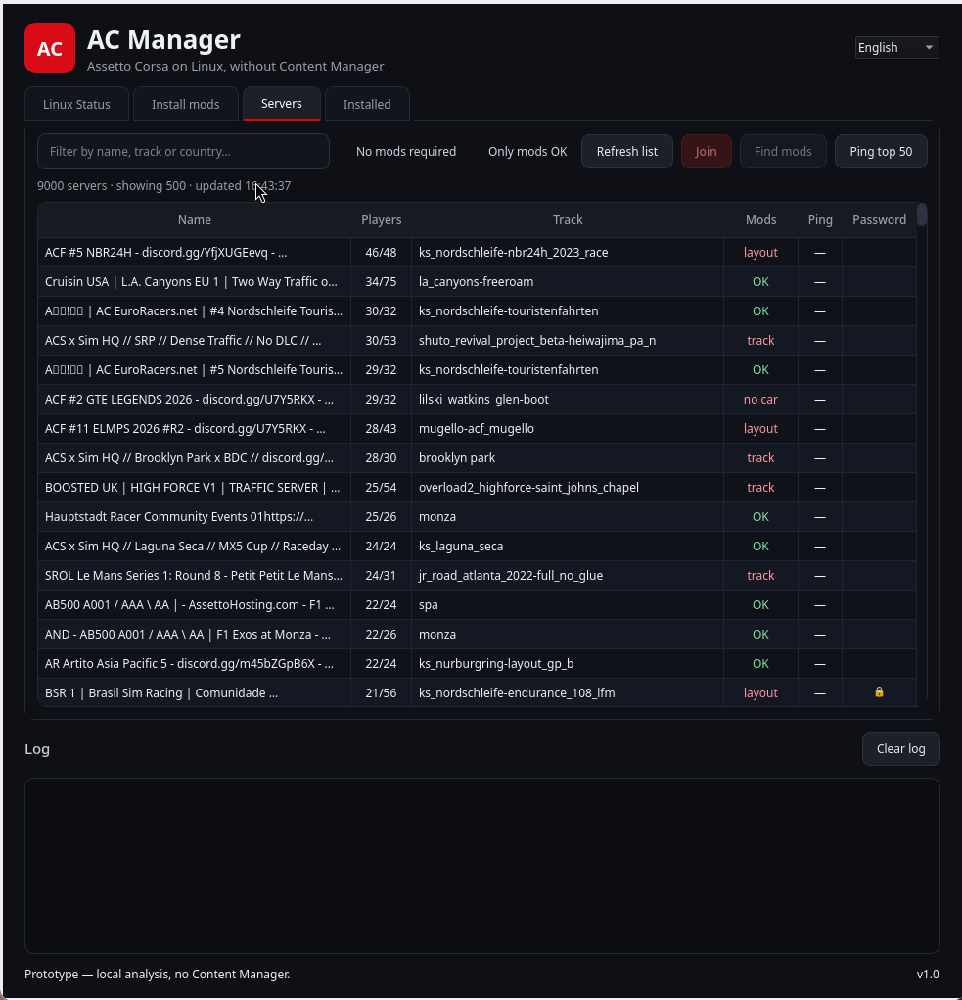

# AC Manager — Assetto Corsa on Linux

[](https://github.com/luizilha/acm-manager/actions/workflows/build-appimage.yml)
[**Download the latest AppImage**](https://github.com/luizilha/acm-manager/releases/latest/download/acm-manager-1.1.1-x86_64.AppImage)

A desktop manager for **Assetto Corsa on Linux**, built to replace the parts of
Content Manager that Linux users actually need: environment setup, mod
installation, track catalog, server browsing, joining servers, and installed
content management.



> Independent project. Not affiliated with Kunos Simulazioni, Content Manager,
> or any server community or mod author. Assetto Corsa is a trademark of Kunos
> Simulazioni.

## What you can do

- **See if your Linux setup is ready** — Steam, Assetto Corsa, Proton, CSP,
  fonts, `dwrite`, protontricks, CSP cache, and your distro.
- **Install mods without a terminal** — drag and drop a `.zip`, `.rar`, `.7z`
  or `.tar.gz`, choose a file, or paste a direct URL.
- **Browse and search a track catalog** — install tracks and layout packs
  directly from Google Drive, MediaFire, or direct URLs when the catalog
  provides them.
- **Browse the AC lobby** — filter by name, track, country, **No mods required**,
  or **Only mods OK**; ping the visible servers; inspect details and missing
  content.
- **Join a server** — the app writes the correct car, track, CSP build, CSP
  features, driver GUID, and server details to `race.ini` before launching AC.
- **See what is installed** — third-party content is shown by default, with
  sizes, search, and safe deletion to a local trash folder.
- **Use it in English or Portuguese** — switch language live from the header.

## Download and run

1. Download the AppImage:
   [latest release](https://github.com/luizilha/acm-manager/releases/latest/download/acm-manager-1.1.1-x86_64.AppImage)
2. Make it executable and run:

```bash
chmod +x acm-manager-1.1.1-x86_64.AppImage
./acm-manager-1.1.1-x86_64.AppImage
```

The AppImage is built automatically by GitHub Actions on every push to `main`
and on every version tag. It is not committed to the repository; releases hold
the downloadable binaries.

If FUSE is unavailable:

```bash
APPIMAGE_EXTRACT_AND_RUN=1 ./acm-manager-1.1.1-x86_64.AppImage
```

Requirements, per-distro packages, Proton/CSP details, and troubleshooting are
in **[SETUP.md](SETUP.md)**. Version history is in **[CHANGELOG.md](CHANGELOG.md)**.

## First run — graphical workflow

### 1. Linux Status

Open the **Linux Status** tab.

- Check the cards for Steam, Assetto Corsa, Proton, CSP, fonts, `dwrite`,
  protontricks, CSP cache, and distro.
- Click **Set up everything** to install/verify Proton-GE 9-20, CSP, fonts,
  protontricks, and the system dependencies used for archive extraction.
- Close Steam first when the wizard asks, so it can change the AC Proton
  version safely.
- If the AC prefix does not exist yet, open Assetto Corsa once through Steam
  and run the check/setup again.

The wizard is idempotent: already-correct components are detected and skipped.

To configure your controller, use **Open in default mode** in the Linux Status
tab: it restores the original AC launcher and opens the game through Steam, so
you can bind inputs in **Options → Controls**. The next server join re-applies
the direct launch.

### 2. Install mods

Open **Install mods**:

- drag an archive anywhere onto the window, or
- click **Choose file…**, or
- paste a direct download URL and click **Download from URL**, or
- click **No Hesi cars (CDN)** to browse and install cars from
  `cdn.nohesi.gg` (mark only what you need; the full index is ~45 GiB).

The app extracts the archive to a staging directory, detects cars, tracks,
layouts, apps, weather, fonts, and CSP, then copies only the recognized content
into Assetto Corsa.

### 3. Find a server

Open **Servers**:

- review the lobby list;
- use **No mods required** for servers whose track/layout and cars are all
  official base/DLC content;
- use **Only mods OK** for servers where all required content is already
  installed;
- click **Find mods** to see exactly what is missing and open the track catalog;
  No Hesi cars install straight from their CDN when clicked, and **Install all
  No Hesi** downloads every missing one for that server;
- when the server advertises download links (in its details or name — Discord,
  Google Drive, MediaFire, direct files), the same dialog lists them under
  **Where to download** and offers **Download and install** for supported hosts;
- click **Join** to choose an allowed installed car and enter the server; the
  picker shows the car's showroom preview, brand/class and specs from
  `ui_car.json`.
- if the chosen car has no free slot on that instance, the app warns before
  launching and offers another instance of the same track with a free slot, or
  another installed car that has one;
- Assetto Corsa loads **every** car model in the server's entry list, not only
  yours. If any are missing, the app explains it and can download them from the
  server itself when it provides `content.cars` links.

The app also reads the server's extended details to warn about license/password
or entry-list restrictions, and writes the server's CSP features to `race.ini`.

### 4. Manage installed content

Open **Installed**:

- third-party items are shown by default;
- selecting an item shows its preview (car showroom image or track map),
  metadata and path in the right panel;
- enable **Show official (base/DLC)** to include Kunos content;
- select one or more items and use **Delete selected**;
- deletion moves content to `~/.local/share/acm/trash`, not permanent removal.

## Important limitations

- This app does **not** include Assetto Corsa, CSP, Content Manager, cars,
  tracks, fonts, or mods. You still need to own Assetto Corsa and obtain
  third-party content yourself.
- Some servers require a **license/password**, entry list, or whitelist. The app
  can warn and fill server-advertised CSP features, but it does not bypass
  access restrictions.
- The track catalog covers tracks, not cars. Catalog links can become stale.
- Sharemods, Mega, Patreon, RaceDepartment/Overtake, and Ko-fi need a browser or
  login; only direct links, Google Drive, MediaFire, and `acstuff.ru` are
  downloaded automatically.
- RAR extraction needs `unrar`; 7z needs `7z`/`7zz` or `bsdtar`.

## Build from source

```bash
git clone https://github.com/luizilha/acm-manager.git
cd acm-manager
python3 -m venv .venv
.venv/bin/pip install -r requirements.txt
.venv/bin/python acm_gui.py
```

Build the AppImage:

```bash
./build_appimage.sh
```

The script installs build dependencies into `.venv` from
`requirements-build.txt`, runs PyInstaller, and creates
`acm-manager-1.1.1-x86_64.AppImage`.

## Architecture

```text
acm.py                  compatibility facade + CLI entry point
acm_lib/                core: detection, downloads, catalog, content, servers,
                        installer, setup, CLI
acm_gui.py              GUI entry point
gui/
  main_window.py        window shell, tabs, shared log/task runner
  tabs/
    linux_status.py     Linux Status tab
    install_mods.py     Install mods tab
    servers.py          Servers tab
    catalog_dialog.py   missing-content and track-catalog dialog
    installed.py        Installed tab
  i18n.py               English/Portuguese UI strings
  theme.py              Qt theme
```

The GUI depends on `acm_lib` through `acm.py`; the core does not depend on Qt.
See [SETUP.md](SETUP.md) for the technical details, file locations, and
troubleshooting.

## Development and releases

- `main` builds a rolling AppImage and updates the `latest` release.
- Tags like `v1.1` create versioned releases.
- Every workflow run also uploads an AppImage artifact.
- Source checks: `python3 -m py_compile acm.py acm_gui.py acm_lib/*.py gui/*.py gui/tabs/*.py`.

## Contributing

Issues and pull requests are welcome. Please include your distro, Steam/Proton
configuration, and the relevant log lines. See [CONTRIBUTORS.md](CONTRIBUTORS.md)
for credits and AI-assistance disclosure.

## License

MIT — see [LICENSE](LICENSE). Third-party notices are in
[THIRD_PARTY_NOTICES.md](THIRD_PARTY_NOTICES.md).
